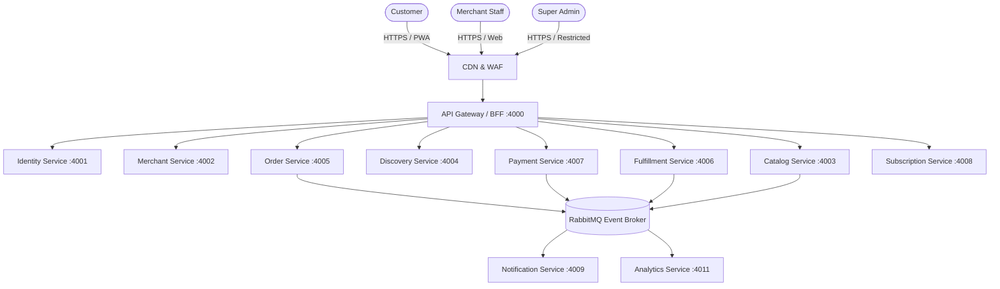

# System Context & C4 Architecture

NukkadNow connects hyper-local consumers with neighborhood merchants (kirana stores, home chefs, bakers, makers) through order-ahead, time-slot pickup, and merchant-managed delivery.

